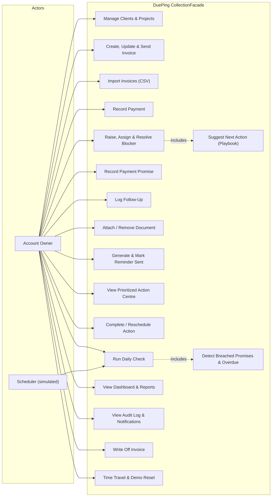

# UML Diagram 01 — Use Case Diagram

### Primary Actors
- **Account Owner**: Freelancer, agency owner, or finance manager managing receivables and client follow-ups.
- **Scheduler (simulated)**: Automated cron runner invoking the daily check service to detect overdue invoices and missed promises.

### Rendering Note
PlantUML source is available at [01-use-case.puml](01-use-case.puml). A structural breakdown is rendered below.

