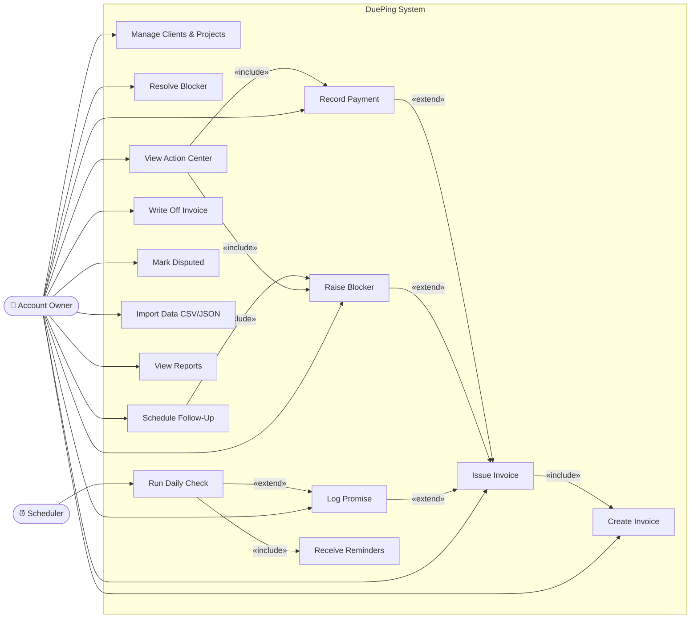

# UML Diagram 01 — Use Case Diagram

## Actors & Use Cases

## Notes

| Actor | Description |
|-------|-------------|
| Account Owner | The freelancer/agency user managing their receivables |
| Scheduler | Automated daily cron job that runs DailyCheckService |

| Use Case | Primary Actor | Description |
|----------|--------------|-------------|
| Manage Clients & Projects | Account Owner | CRUD operations on clients and their projects |
| Create Invoice | Account Owner | Create a draft invoice for a project |
| Issue Invoice | Account Owner | Transition invoice from DRAFT to ISSUED |
| Record Payment | Account Owner | Record full or partial payment |
| Raise Blocker | Account Owner | Identify a reason payment is blocked |
| Resolve Blocker | Account Owner | Mark a blocker as resolved |
| Log Promise | Account Owner | Record a client's verbal payment commitment |
| Schedule Follow-Up | Account Owner | Schedule a follow-up communication |
| View Action Center | Account Owner | See prioritized list of invoices needing attention |
| Write Off Invoice | Account Owner | Write off an uncollectable invoice |
| Mark Disputed | Account Owner | Flag an invoice as disputed |
| Import Data | Account Owner | Bulk import from CSV or JSON |
| View Reports | Account Owner | View aging, cash-flow, collection reports |
| Run Daily Check | Scheduler | Detect overdue invoices, evaluate promises, send reminders |
| Receive Reminders | Account Owner | Automated reminders generated by the system |
