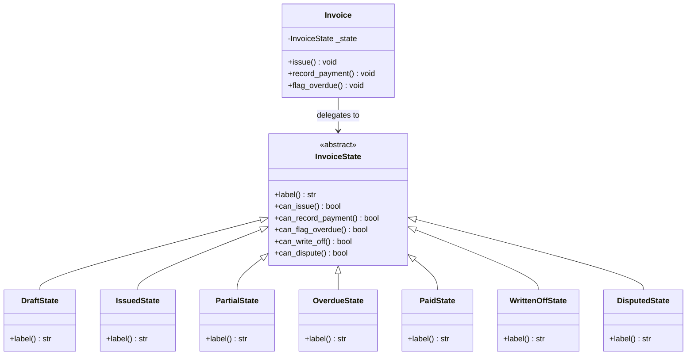
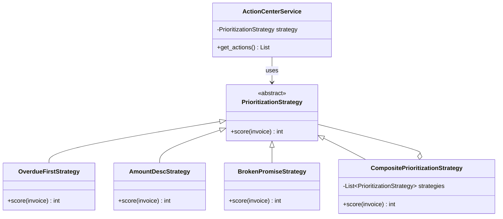
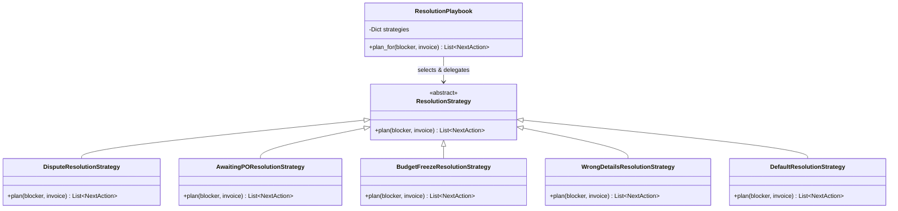
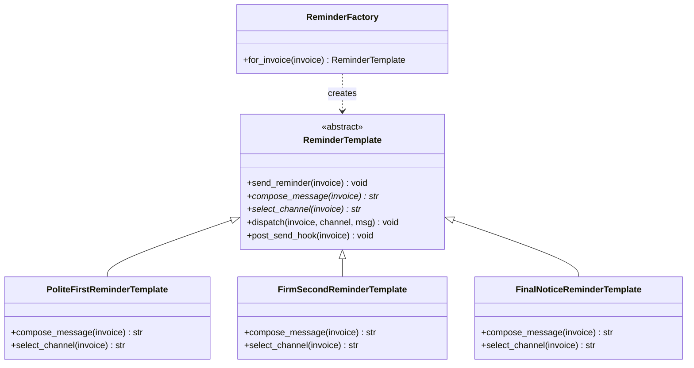
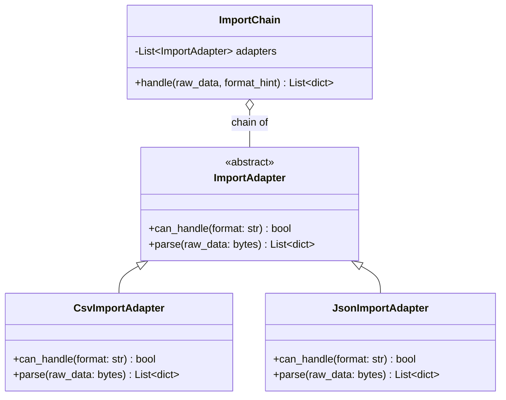
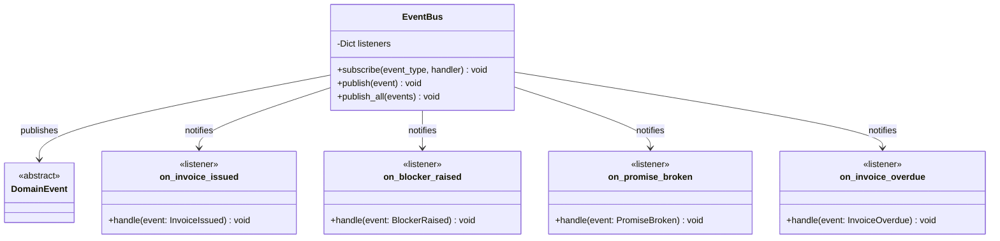
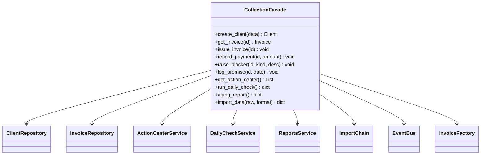
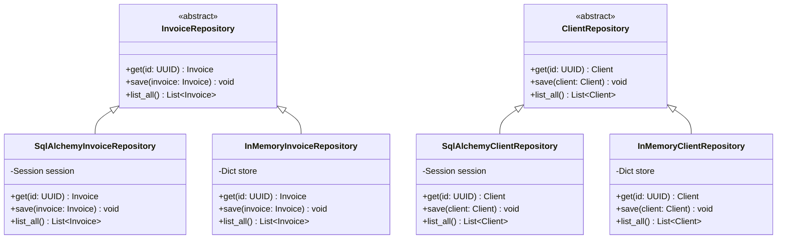

# UML Diagram 03 — Design Patterns

## Pattern 1: State (Invoice Lifecycle)

---

## Pattern 2: Strategy — Prioritization

---

## Pattern 3: Strategy — Resolution Playbook

---

## Pattern 4: Template Method + Factory (Reminders)

---

## Pattern 5: Adapter + Chain of Responsibility (Import)

---

## Pattern 6: Observer (EventBus + Listeners)

---

## Pattern 7: Facade (CollectionFacade)

---

## Pattern 8: Repository (Ports + Adapters)

