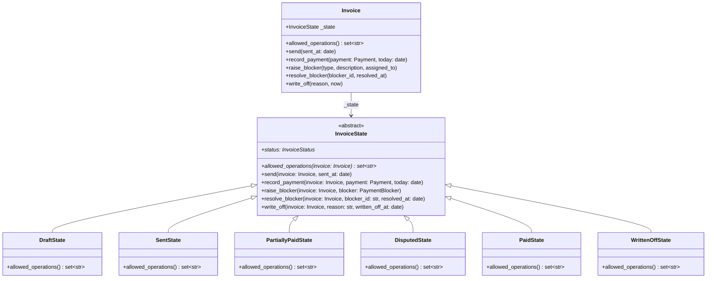
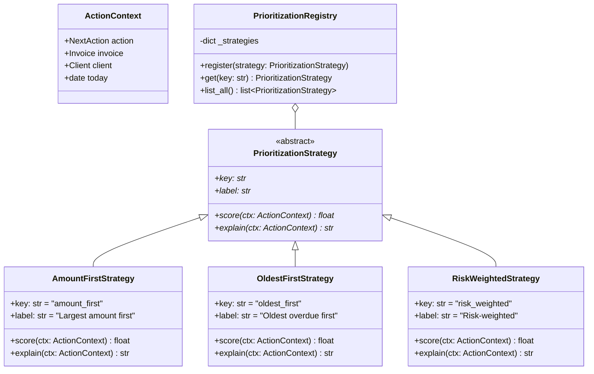
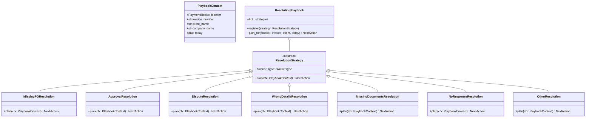
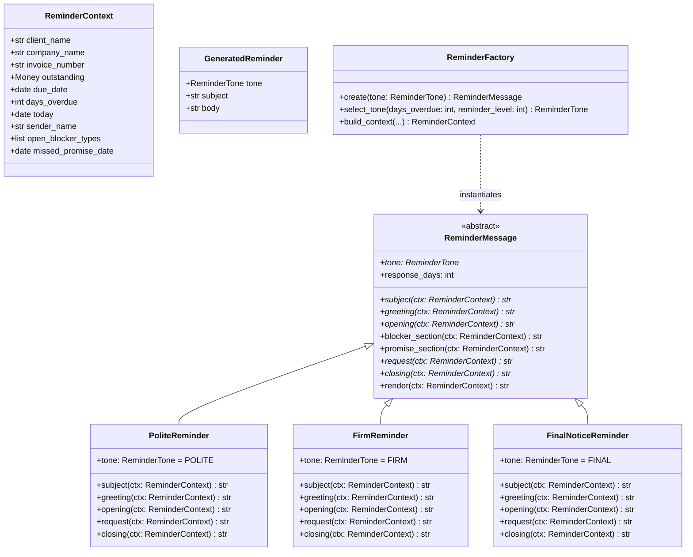
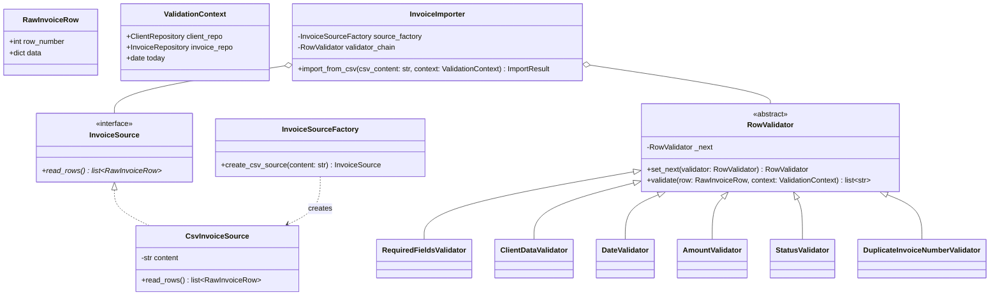
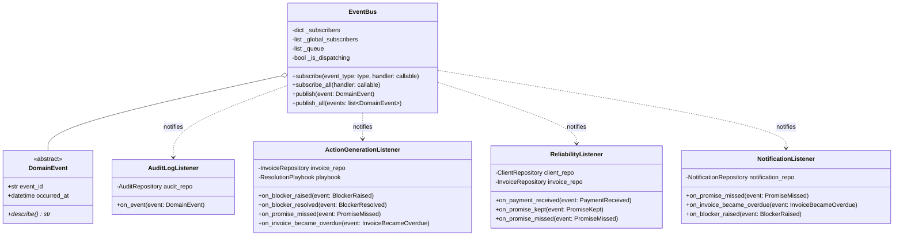
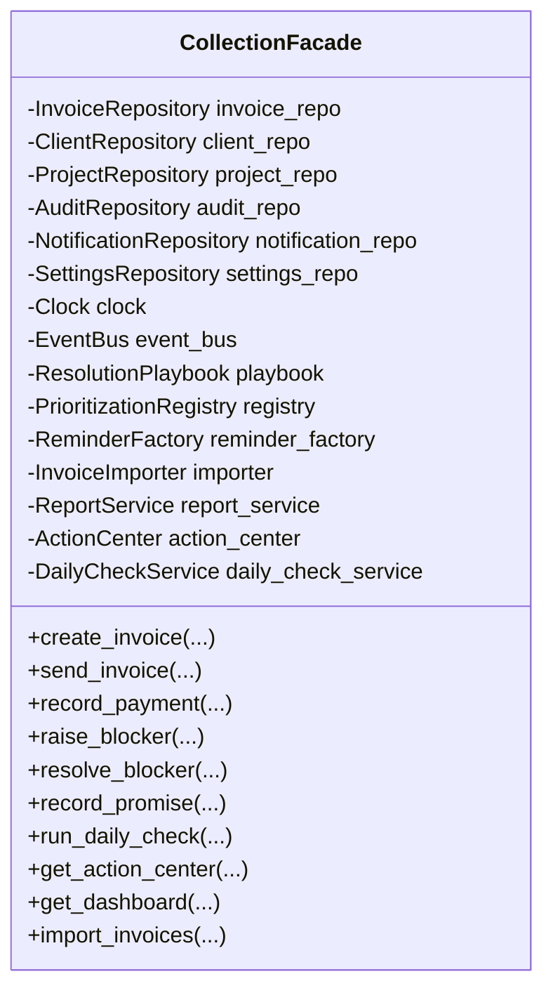
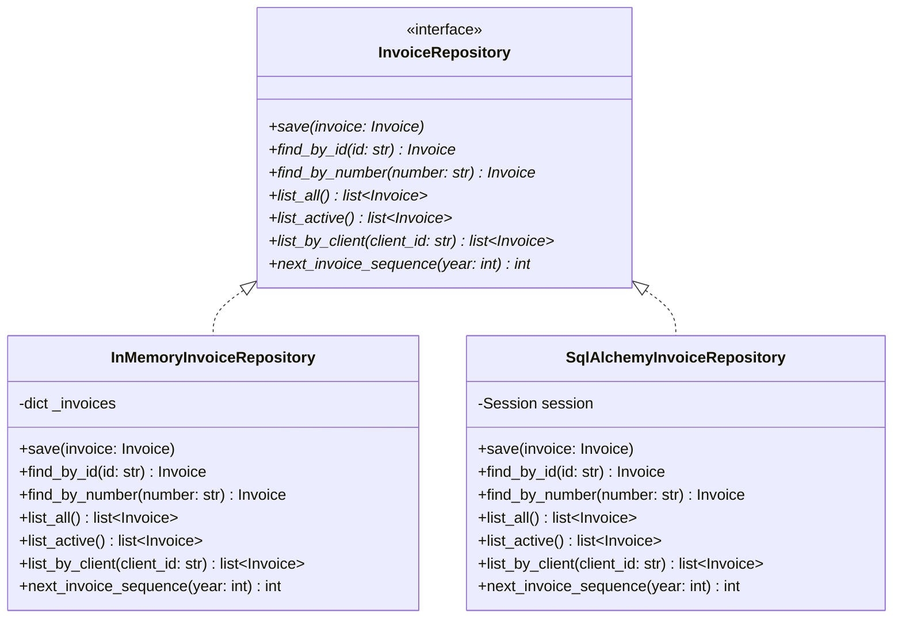

# UML Diagram 03 — Design Patterns

### 1. State Pattern (Invoice Lifecycle)

Encapsulates invoice behavior and allowed operations across its lifecycle stages. Note that *Overdue* is a temporal projection (`is_overdue(today)`), not a separate state class.

---

### 2. Strategy Pattern (Action Prioritization)

Allows hot-swapping ranking algorithms for sorting high-priority tasks in the Action Centre.

---

### 3. Strategy Pattern (Resolution Playbook)

Maps the root cause of an unpaid invoice (the `PaymentBlocker`) to an optimal next recovery action.

---

### 4. Template Method + Factory (Adaptive Reminders)

Defines a rigid communication structure with polymorphic variation across tones. `ReminderFactory` acts as a Simple Factory.

---

### 5. Adapter + Chain of Responsibility (CSV Import)

Adapts external raw files into structured domain inputs and pipes each row through an extensible chain of validators.

---

### 6. Observer Pattern (Domain Event Bus)

Decouples domain aggregate changes from side effects (audit logging, action generation, reliability updates, and notifications).

---

### 7. Facade Pattern

Unifies application operations behind a cohesive, single-point entry for API routers and external clients.

---

### 8. Repository Pattern

Decouples business domain logic from database engines and storage mechanisms.

