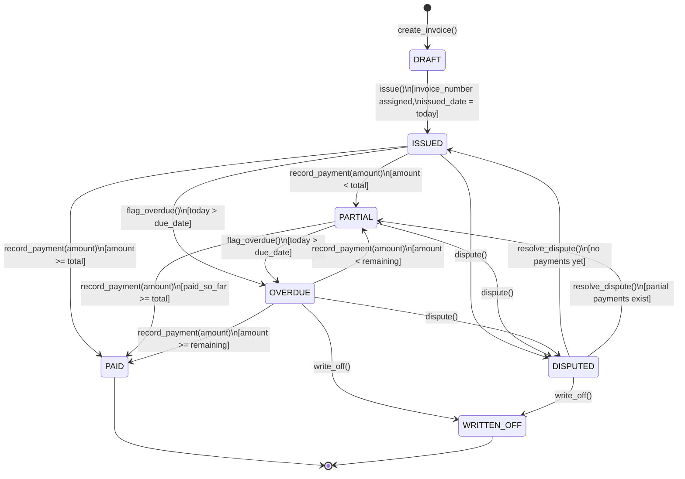

# UML Diagram 04 — Invoice State Machine

## Transition Table

| From State | Event / Guard | To State | Domain Event Fired |
|-----------|--------------|----------|--------------------|
| DRAFT | `issue()` | ISSUED | `InvoiceIssued` |
| ISSUED | `record_payment()` [partial] | PARTIAL | `PaymentRecorded` |
| ISSUED | `record_payment()` [full] | PAID | `PaymentRecorded`, `InvoicePaid` |
| ISSUED | `flag_overdue()` | OVERDUE | `InvoiceOverdue` |
| ISSUED | `dispute()` | DISPUTED | `InvoiceDisputed` |
| PARTIAL | `record_payment()` [completes] | PAID | `PaymentRecorded`, `InvoicePaid` |
| PARTIAL | `flag_overdue()` | OVERDUE | `InvoiceOverdue` |
| PARTIAL | `dispute()` | DISPUTED | `InvoiceDisputed` |
| OVERDUE | `record_payment()` [partial] | PARTIAL | `PaymentRecorded` |
| OVERDUE | `record_payment()` [full] | PAID | `PaymentRecorded`, `InvoicePaid` |
| OVERDUE | `write_off()` | WRITTEN_OFF | `InvoiceWrittenOff` |
| OVERDUE | `dispute()` | DISPUTED | `InvoiceDisputed` |
| DISPUTED | `resolve_dispute()` [no payments] | ISSUED | `BlockerResolved` |
| DISPUTED | `resolve_dispute()` [partial paid] | PARTIAL | `BlockerResolved` |
| DISPUTED | `write_off()` | WRITTEN_OFF | `InvoiceWrittenOff` |

## Terminal States

- **PAID** — Invoice fully collected. No further transitions.
- **WRITTEN_OFF** — Invoice deemed uncollectable. No further transitions.
