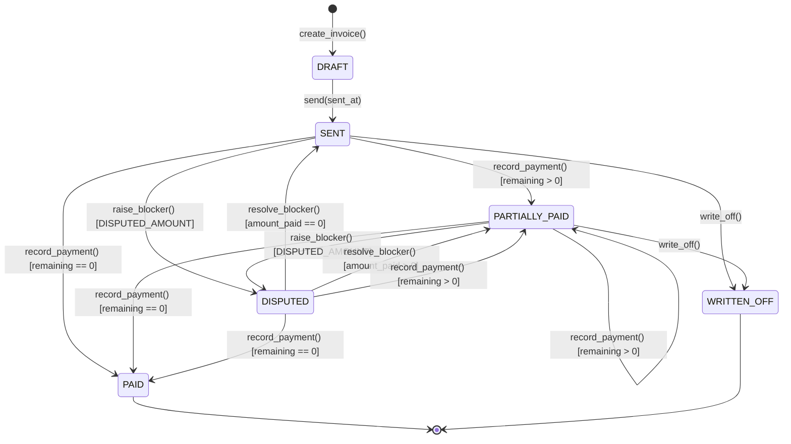

# UML Diagram 04 — Invoice State Machine

> **Important Architectural Note:**  
> **Overdue is derived, not a stored state.** An invoice is overdue when its status is active (`SENT`, `PARTIALLY_PAID`, or `DISPUTED`), its outstanding balance is greater than zero, and the evaluation date `today > due_date` (evaluated dynamically via `invoice.is_overdue(today)`). This avoids corrupting state machines with wall-clock polling.

