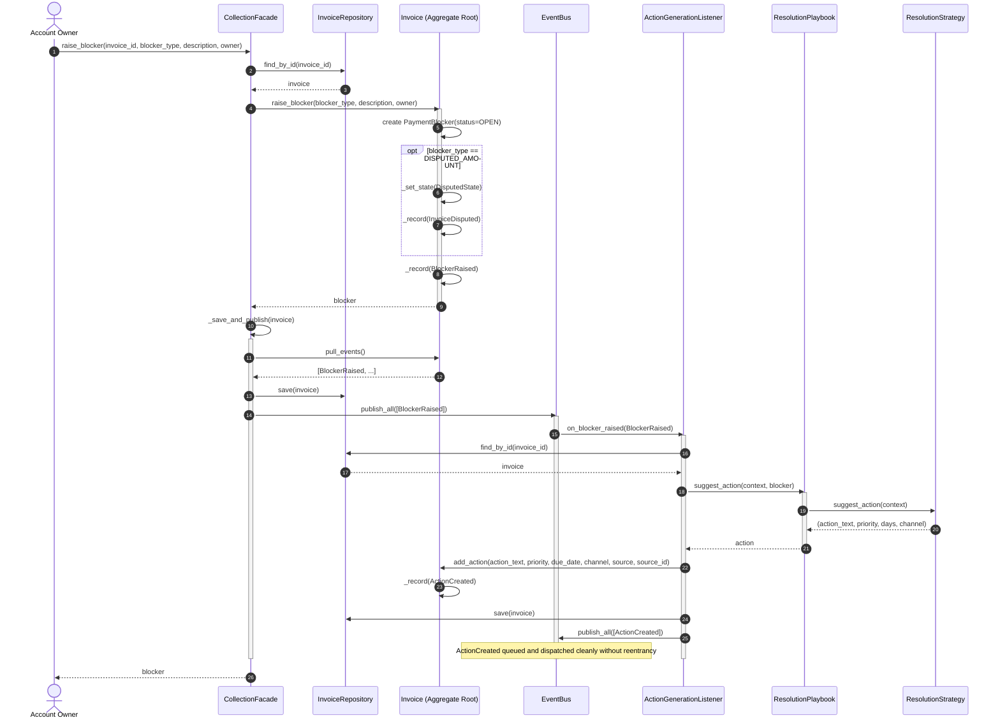

# UML Diagram 06 — Sequence: Blocker to Action Generation

Traces how raising a `PaymentBlocker` triggers the domain event pipeline and uses the `ResolutionPlaybook` to generate a targeted `NextAction`.

