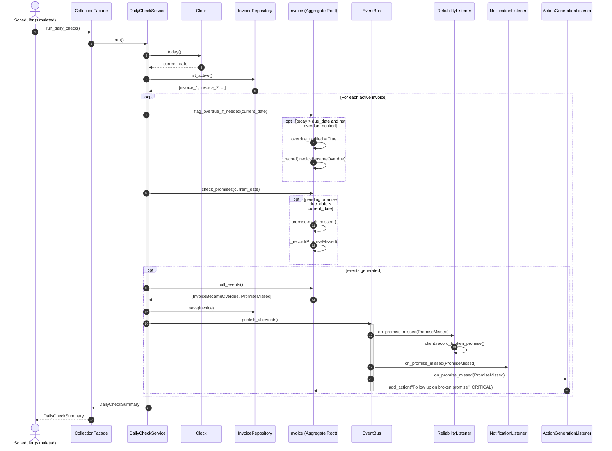

# UML Diagram 07 — Sequence: Daily Check

Traces how `DailyCheckService` evaluates active invoices against `Clock.today()`, detecting newly overdue invoices, breached promises, and aging blockers.

