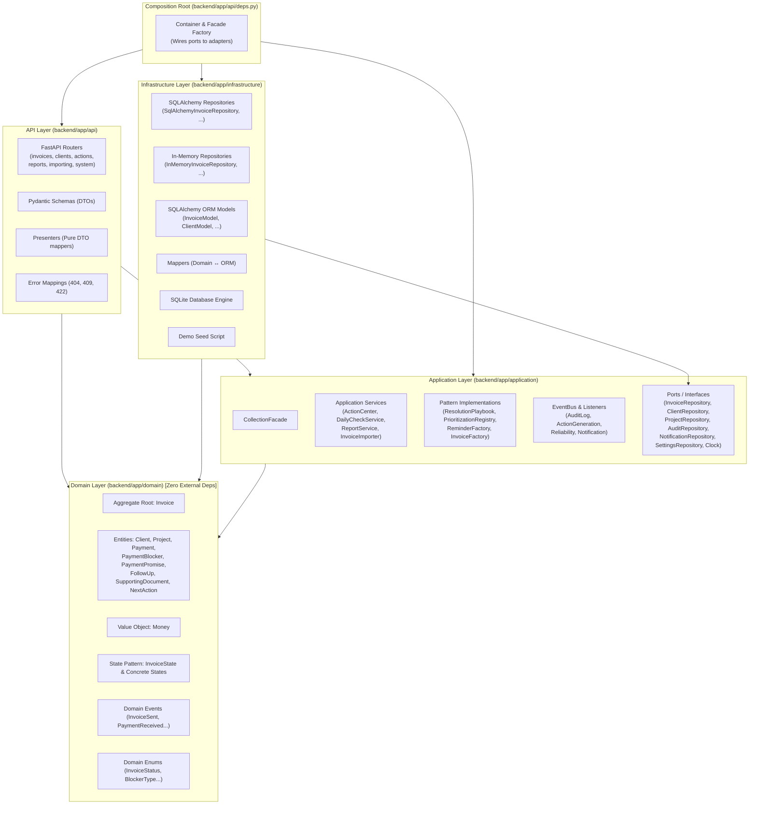

# UML Diagram 08 — Layered Architecture & Dependency Rule

Strict Clean / Onion Architecture dependency direction:
$$\text{API} \longrightarrow \text{Application} \longrightarrow \text{Domain} \longleftarrow \text{Infrastructure}$$

- **Domain Layer (`backend/app/domain/`)**: Pure Python standard library with zero external dependencies. Defines aggregates, entities, value objects, domain events, domain exceptions, and business rules.
- **Application Layer (`backend/app/application/`)**: Coordinates use cases, domain events, and workflows via ports (interfaces). Depends only on the Domain Layer.
- **Infrastructure Layer (`backend/app/infrastructure/`)**: Implements application ports using SQLAlchemy, SQLite, and in-memory stores. Depends on Application and Domain layers.
- **API Layer (`backend/app/api/`)**: FastAPI routers, Pydantic DTOs, HTTP presenters, and error handlers. Depends on Application and Domain layers.
- **Composition Root (`backend/app/api/deps.py`)**: Wires infrastructure implementations into the `CollectionFacade` singleton during application startup.

