# UML Diagram 08 — Layer Architecture

```mermaid
flowchart TD
    subgraph API ["API Layer (app/api/)"]
        direction TB
        A1["FastAPI Routers\n(clients, invoices, actions,\nreports, system, importing)"]
        A2["Pydantic Schemas"]
        A3["Presenters"]
        A4["Error Handlers"]
        A5["Dependency Injection (deps.py)"]
    end

    subgraph APP ["Application Layer (app/application/)"]
        direction TB
        B1["CollectionFacade"]
        B2["DailyCheckService"]
        B3["ActionCenterService"]
        B4["ReportsService"]
        B5["InvoiceFactory"]
        B6["ResolutionPlaybook\n+ Strategies"]
        B7["ReminderTemplates"]
        B8["ImportChain\n+ Adapters"]
        B9["EventBus + Listeners"]
        B10["Ports / Interfaces\n(InvoiceRepository,\nClientRepository, UnitOfWork)"]
        B11["ClockPort"]
    end

    subgraph DOM ["Domain Layer (app/domain/)"]
        direction TB
        C1["Entities\n(Invoice, Client, Project)"]
        C2["Value Objects\n(Money, Payment)"]
        C3["Enums\n(InvoiceStatus, BlockerKind, ...)"]
        C4["InvoiceState + Concrete States"]
        C5["Domain Events"]
        C6["Exceptions"]
        C7["Child Entities\n(PaymentBlocker, PaymentPromise,\nFollowUp, NextAction, ...)"]
    end

    subgraph INFRA ["Infrastructure Layer (app/infrastructure/)"]
        direction TB
        D1["SQLAlchemy ORM Models"]
        D2["SQLAlchemy Repositories\n(implements Ports)"]
        D3["In-Memory Repositories\n(implements Ports)"]
        D4["Mappers (ORM ↔ Domain)"]
        D5["Database Config (db.py)"]
        D6["Seed Script"]
    end

    API -->|"calls via Facade"| APP
    APP -->|"uses domain entities"| DOM
    APP -->|"depends on (via ports)"| B10
    INFRA -->|"implements"| B10
    INFRA -->|"maps to/from"| DOM

    style DOM fill:#d4edda,stroke:#28a745,color:#000
    style APP fill:#d1ecf1,stroke:#17a2b8,color:#000
    style API fill:#fff3cd,stroke:#ffc107,color:#000
    style INFRA fill:#f8d7da,stroke:#dc3545,color:#000
```

## Dependency Rule

> **Inner layers never import from outer layers.**

| Layer | May Import From |
|-------|----------------|
| Domain | stdlib only — no FastAPI, SQLAlchemy, Pydantic |
| Application | Domain (entities, events, exceptions) |
| Infrastructure | Domain + Application (ports only) + SQLAlchemy |
| API | Application (Facade) + Pydantic |

## Key Interfaces (Ports)

| Port | Defined In | Implemented By |
|------|-----------|----------------|
| `InvoiceRepository` | `application/ports.py` | `SqlAlchemyInvoiceRepository`, `InMemoryInvoiceRepository` |
| `ClientRepository` | `application/ports.py` | `SqlAlchemyClientRepository`, `InMemoryClientRepository` |
| `ProjectRepository` | `application/ports.py` | `SqlAlchemyProjectRepository`, `InMemoryProjectRepository` |
| `UnitOfWork` | `application/ports.py` | `SqlAlchemyUnitOfWork` |
| `ClockPort` | `application/clock.py` | `SystemClock`, `FakeClock` (tests) |
