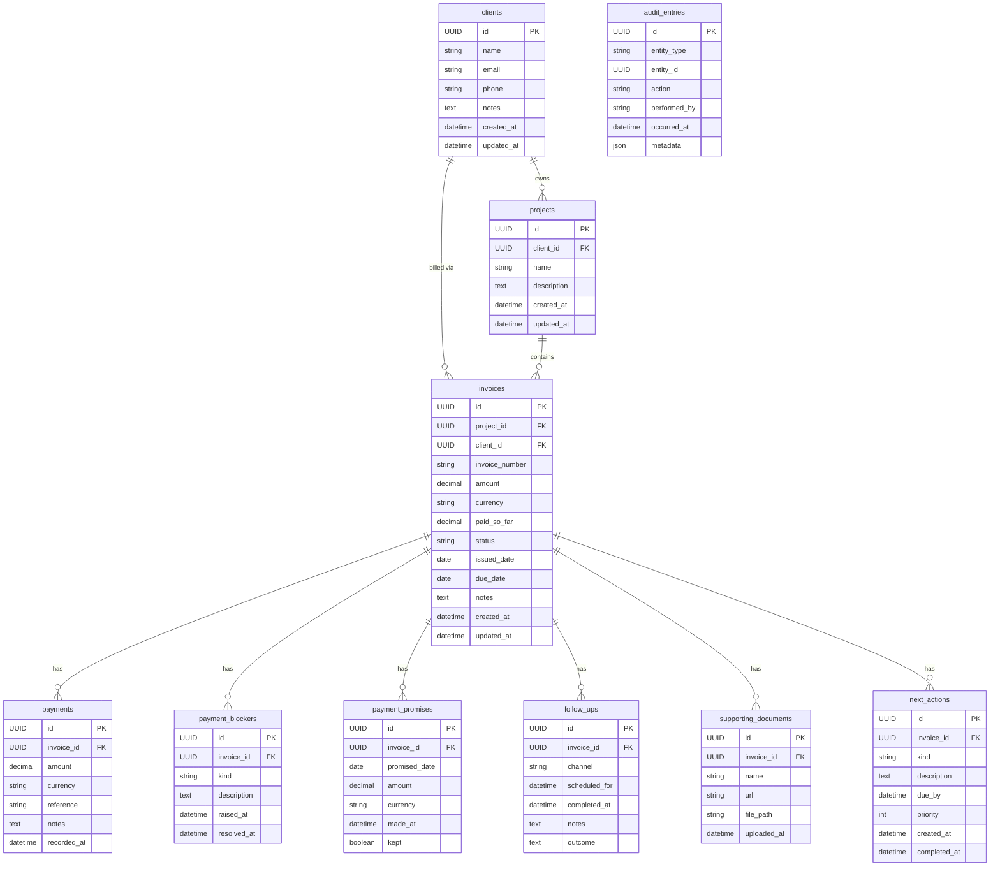

# UML Diagram 09 — Entity-Relationship Diagram

## Table Notes

| Table | Notes |
|-------|-------|
| `clients` | Top-level aggregate. Owns projects and (denormalized) invoices. |
| `projects` | Belongs to one client. Groups invoices. |
| `invoices` | Central table. `client_id` is denormalized from project for query convenience. `status` persisted as string. `paid_so_far` is maintained by application layer. |
| `payments` | Immutable once recorded. Amount in invoice currency. |
| `payment_blockers` | `resolved_at IS NULL` means still active. |
| `payment_promises` | `kept = NULL` means pending evaluation. |
| `follow_ups` | `completed_at IS NULL` means pending. |
| `supporting_documents` | Either `url` or `file_path` is populated. |
| `next_actions` | `completed_at IS NULL` means active. Lower `priority` = more urgent. |
| `audit_entries` | Append-only. `entity_id` is a generic reference (not an FK). |
